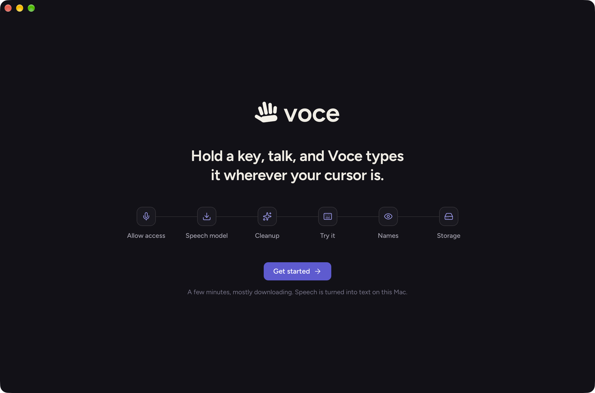
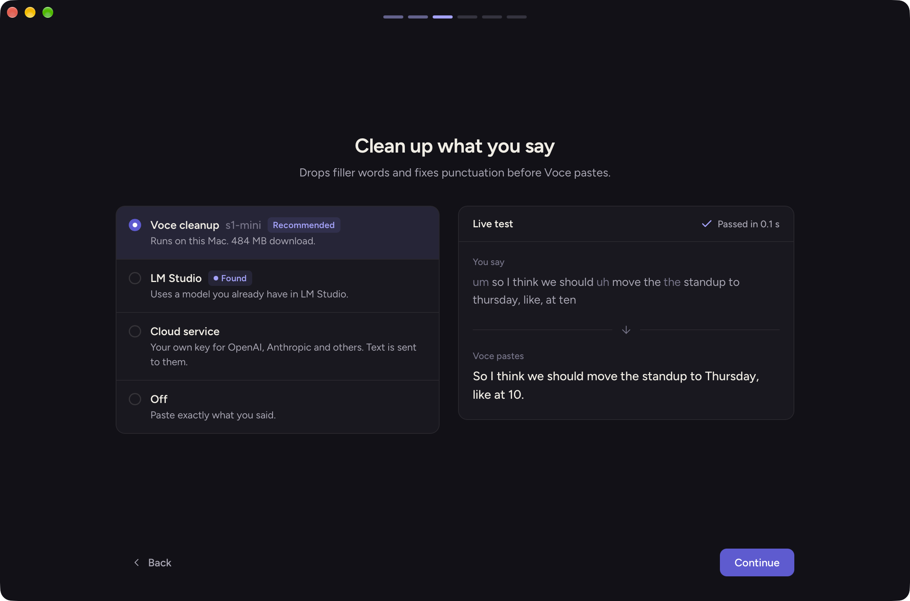
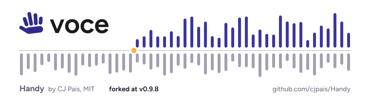

<p align="center">
  
</p>

<h1 align="center">
  <picture>
    <source media="(prefers-color-scheme: dark)" srcset="docs/assets/voce-wordmark-on-dark.svg">
    
  </picture>
</h1>

<p align="center">Private, on-device dictation for macOS.<br>An open-source alternative to Wispr Flow.</p>

<p align="center">
  <a href="https://github.com/Ed-Key/voce/releases/latest/download/Voce.dmg"><b>Download Voce for Mac</b></a>
  <br>
  <sub>Apple Silicon, macOS 14.4 or later. Free and open source.</sub>
</p>

Hold a key, speak, let go: your words are transcribed on your Mac, cleaned up by a small model that also runs on your Mac, and pasted into whatever app you are using. By default, nothing you say leaves your computer.

<p align="center">
  <picture>
    <source media="(prefers-color-scheme: light)" srcset="docs/assets/screenshot-history-light.png">
    
  </picture>
</p>

## Install

1. Download [Voce for Mac](https://github.com/Ed-Key/voce/releases/latest/download/Voce.dmg) and open it.
2. Drag Voce to Applications, then open it.
3. The first time, macOS says it cannot check the app for malicious software, because Voce is not notarized by Apple. Open System Settings, then Privacy & Security, scroll down and click **Open Anyway**.

You only do step 3 once. After that Voce updates itself, and the permissions you grant stay in place. Older versions are on the [Releases](https://github.com/Ed-Key/voce/releases) page.

## First launch

A short setup walks you through everything Voce needs. Most of the time goes to downloading two models.

<p align="center">
  
</p>

1. **Allow access.** Microphone, to hear you while you hold the key, and Accessibility, to paste into the app you are using.
2. **Speech model.** Downloads the recommended model (about 700 MB). It turns your voice into text on your Mac.
3. **Cleanup.** Downloads Voce cleanup (about 480 MB), a small model that drops filler words and fixes punctuation, and tests it on a sample sentence so you see what it does before you rely on it. You can also use a model you already run in LM Studio or Ollama, your own key for a cloud service, or turn cleanup off.
4. **Try it.** Hold Option and Space, say something, let go, and your words appear in a practice box.
5. **Names.** Shows how Voce reads the names in the window you are typing in so they come out spelled right.
6. **Storage.** Shows what Voce keeps on your Mac and how much space it uses.

<p align="center">
  
</p>

## What it does

<p align="center">
  <picture>
    <source media="(prefers-color-scheme: light)" srcset="docs/assets/overlay-light.gif">
    
  </picture>
</p>

- **Dictation.** Push-to-talk speech to text with a streaming speech model running on your Mac's GPU. While you hold the key, a small overlay shows your words as you say them. When you let go, the text is pasted into the app you were using.
- **Cleanup while you speak.** Voce cleanup (the `s1-mini` model) removes filler words, fixes punctuation and adds paragraphs. It cleans the text while you are still talking, so after you let go it only has to finish the last sentence. Pick a style (casual to formal), prose or lists, and email layout in Settings > Cleanup.
- **Names spelled right.** Voce reads the names visible in the window you are typing in, such as people, projects and products, and uses them while it listens. It skips password fields and what it reads stays on your Mac. You can turn it off in Settings > Advanced.
- **Meeting notes (needs extra setup).** Records both sides of a call, transcribes them live and writes a summary afterwards, without sending audio anywhere. For now this needs a few tools installed by hand; see [Meeting notes](#meeting-notes).

## Compared with Wispr Flow

Voce aims to feel like Wispr Flow's dictation while keeping your voice on your Mac.

| | Voce | Wispr Flow |
|---|---|---|
| Speech recognition | On your Mac | On Wispr's servers |
| Cleanup (punctuation, filler words, paragraphs) | While you speak, on your Mac, or with a cloud model you choose, or off | While you speak, on Wispr's servers |
| Audio leaves your Mac | No | Yes |
| Source code | Open source (MIT) | Closed |
| Cost | Free | Free tier with a weekly word limit, paid plans |
| Platforms | macOS | macOS, Windows, iPhone, Android |
| Setup | A guided setup on first launch | Sign in and go |

**Speed.** Time from letting go of the key to the text appearing, on 100 to 200 word dictations (about a minute of speech), same speaker, same Mac (Apple M5 Pro):

| | Median release to paste | Dictations measured |
|---|---|---|
| Voce, cleanup while you speak, `s1-mini` | 734 ms | 15 |
| Wispr Flow, all models | 842 ms | 58 |
| Wispr Flow, `canto 1.0.1` model | 649 ms | |

Wispr Flow's numbers come from its own timing records in the same person's history. In typical use the two feel about the same. Voce's slow cases are slower: its slowest of the 15 took 3.6 seconds, while 9 in 10 Wispr Flow dictations finished within 1.5 seconds. This is a small sample from one person, not a benchmark.

## Privacy

- Audio is recorded and transcribed on your Mac. Nothing is uploaded unless you choose a cloud service for cleanup.
- Names Voce reads from your screen stay on your Mac and are never read from password fields.
- API keys for cloud services are stored in the macOS Keychain.
- Dictation audio is kept for 3 days and then deleted; the text stays. Call audio is deleted 3 days after its transcript is complete; transcripts, notes and summaries stay.

## Meeting notes

Call transcripts and summaries run in a separate local worker that is not set up by the installer yet. It needs a config file, `call-ai-runtime.json`, in the app data folder (`~/Library/Application Support/com.edkiboma.voce/`):

```json
{
  "python": "/path/to/python3",
  "asr_model": "/path/to/whisper-large-v3-turbo (an mlx-whisper model folder)",
  "summary_runtime": "/path/to/llama-server",
  "summary_model": "/path/to/a-small-instruct-model.gguf"
}
```

- `python` needs `numpy`, `scipy` and `mlx-whisper` (and optionally `pywebrtc-audio` for echo removal).
- `summary_runtime` is a `llama-server` binary from llama.cpp. Voce ships one inside the app at `Voce.app/Contents/MacOS/llama-server`.
- For live streaming transcription during calls, run `stream-asr/setup.sh` from a clone of this repo. It builds the streaming sidecar, downloads NVIDIA's Nemotron Speech Streaming model (Core ML, under the NVIDIA Open Model License) and adds `stream_asr` and `stream_models` to the config. Without it, Voce falls back to Whisper for live text.

Voce needs Microphone and System Audio Recording permission for calls, and Accessibility permission for call detection in browsers. It detects Discord, FaceTime, Zoom and Google Meet calls and offers to start; it never starts recording on its own.

### Experimental: meeting companion

A companion that reads the live call transcript and offers short pointers under the Mac's notch. It is off by default: turn on Settings > Advanced > Experimental features to try it, which also shows its Memory page. Turning the switch off ends any running companion session. See [docs/terra-experimental.md](docs/terra-experimental.md).

The companion runs on the [Codex CLI](https://github.com/openai/codex) signed in to a ChatGPT plan, and finds the `codex` binary on your PATH. It is a working prototype tied to that setup; making it model-agnostic is planned. Tested with Codex CLI 0.165 and the `gpt-6.1-terra` model; other versions may need changes in `src-tauri/resources/assistie/responder.py`.

An optional second route connects to a ChatGPT task through an OpenAI tunnel. It needs:

- OpenAI's `tunnel-client` (Apache-2.0) placed at `src-tauri/resources/assistie/bin/tunnel-client` and made executable (`chmod +x`) before building; see `src-tauri/resources/assistie/bin/README.txt`.
- Your own tunnel id in `<app data>/assistie/plugin/tunnel-id`, and a key stored from the app.
- Optionally, your ChatGPT plugin page as `VITE_ASSISTIE_PLUGIN_URL` in `.env.local`, which adds an "open" button.

## For developers

You need macOS 14.4 or later (developed on Apple Silicon), [Rust](https://rustup.rs/) (stable), [Bun](https://bun.sh/), Xcode Command Line Tools (`xcode-select --install`) and CMake.

```bash
bun install
scripts/vendor-transcribe-cpp.sh
mkdir -p src-tauri/resources/models
curl -o src-tauri/resources/models/silero_vad_v4.onnx https://blob.handy.computer/silero_vad_v4.onnx
CMAKE_POLICY_VERSION_MINIMUM=3.5 bun run tauri dev
```

`scripts/vendor-transcribe-cpp.sh` prepares the patched speech library that lets Voce use on-screen names while it listens; run it once after cloning. During development, point `VOCE_LLAMA_SERVER` at a `llama-server` binary to use Voce cleanup.

For a release build with Voce cleanup bundled:

```bash
scripts/fetch-llama-server.sh
CMAKE_POLICY_VERSION_MINIMUM=3.5 bun run tauri build --bundles app --config src-tauri/tauri.sidecar.conf.json
```

macOS ties Microphone, Accessibility and System Audio Recording permissions to the app's code signature. An ad-hoc signed build gets a new signature every time, so macOS asks again after each rebuild. To keep permissions across rebuilds, sign with your own certificate by setting `APPLE_SIGNING_IDENTITY="<your certificate name or SHA-1>"` before building.

More detail is in [BUILD.md](BUILD.md), [AGENTS.md](AGENTS.md) and the lifecycle tables in [docs/](docs/).

## Credits and license

<p align="center">
  <a href="https://github.com/cjpais/Handy">
    <picture>
      <source media="(prefers-color-scheme: dark)" srcset="docs/assets/handy-lineage-on-dark.svg">
      
    </picture>
  </a>
</p>

Voce is an independent fork. It is not affiliated with or endorsed by the Handy project, and uses its own name and branding.

Voce is MIT licensed, like Handy. See [LICENSE](LICENSE).

It builds on:

- [Handy](https://github.com/cjpais/Handy) by CJ Pais (MIT), which Voce is forked from at v0.9.8.
- [transcribe.cpp](https://github.com/handy-computer) and [ggml](https://github.com/ggml-org/ggml) for on-device speech recognition.
- [S1-mini](https://huggingface.co/superwhisper/s1-mini) by Superwhisper (Apache-2.0), the model behind Voce cleanup.
- [llama.cpp](https://github.com/ggml-org/llama.cpp) (MIT), which runs Voce cleanup on your Mac.
- NVIDIA's Parakeet and Nemotron speech models, under their own licenses.
- [Silero VAD](https://github.com/snakers4/silero-vad) (MIT) for voice activity detection.
- [FluidAudio](https://github.com/FluidInference/FluidAudio) (Apache-2.0) for streaming transcription on the Neural Engine.
- [Figtree](https://github.com/erikdkennedy/figtree) (SIL Open Font License).

Speech models are downloaded from the model host Handy uses.
