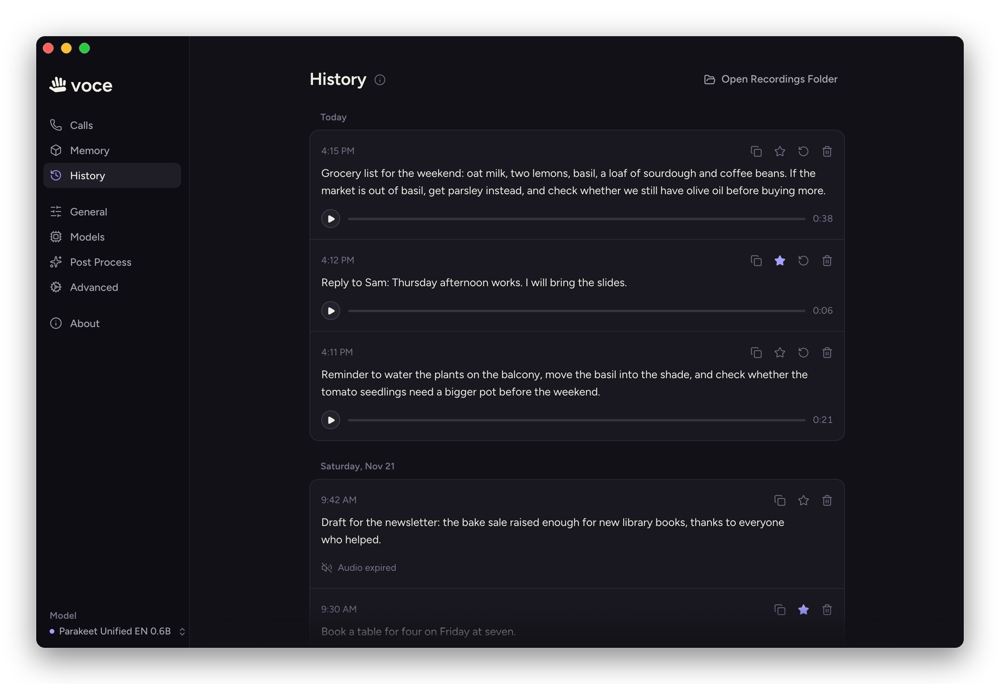

<p align="center">
  
</p>

<h1 align="center">
  <picture>
    <source media="(prefers-color-scheme: dark)" srcset="docs/assets/voce-wordmark-on-dark.svg">
    
  </picture>
</h1>

<p align="center">Private, on-device dictation and meeting notes for macOS.<br>An open-source alternative to Wispr Flow.</p>

Hold a key, speak, let go: your words are transcribed on your Mac, cleaned up by a small local model, and pasted into whatever app you are using. Voce can also take notes on calls, transcribing both sides live and writing a summary afterwards, without sending audio anywhere.

Voce is a personal project built on top of [Handy](https://github.com/cjpais/Handy) by CJ Pais (see [Credits](#credits-and-license)). It is macOS only and parts of it are experimental.

<p align="center">
  <picture>
    <source media="(prefers-color-scheme: light)" srcset="docs/assets/screenshot-history-light.png">
    
  </picture>
</p>

## What it does

<p align="center">
  <picture>
    <source media="(prefers-color-scheme: light)" srcset="docs/assets/overlay-light.gif">
    
  </picture>
</p>

- **Dictation.** Push-to-talk speech to text with a streaming speech model running on the GPU. While you hold the key, a small overlay shows the hand mark: its fingers follow your voice and it nods as each word lands, then the card widens into the live text. When you let go, the text is pasted into the app you were using.
- **Cleanup while you speak.** An optional local language model (for example one served by LM Studio) fixes punctuation, removes filler words and adds paragraphs. With early cleanup on, Voce cleans the text while you are still talking, so after you let go it only has to finish the last sentence. Typical release-to-paste time is well under a second.
- **Meeting notes.** Records the microphone and the other side of a call, transcribes them live with a streaming model on the Neural Engine, removes speaker echo, and writes notes and a summary when the call ends. Detects Discord, FaceTime, Zoom and Google Meet calls and offers to start (it never starts recording on its own).
- **Meeting companion (experimental).** A companion that reads the live transcript and offers short pointers and answers in a slip under the Mac's notch. It currently runs on OpenAI's Codex CLI; see [Experimental: meeting companion](#experimental-meeting-companion).

## Compared with Wispr Flow

Voce aims to feel like Wispr Flow's dictation while keeping your voice on your Mac.

| | Voce | Wispr Flow |
|---|---|---|
| Speech recognition | On your Mac | On Wispr's servers |
| Cleanup (punctuation, filler words, paragraphs) | While you speak, with a local model or a cloud model you choose, or off | While you speak, on Wispr's servers |
| Audio leaves your Mac | No | Yes |
| Source code | Open source (MIT) | Closed |
| Cost | Free | Free tier with a weekly word limit, paid plans |
| Platforms | macOS | macOS, Windows, iPhone, Android |
| Setup | Local cleanup model set up by hand for now | Sign in and go |

**Speed.** Time from letting go of the key to the text appearing, on 100 to 200 word dictations (about a minute of speech), same speaker, same Mac (Apple M5 Pro):

| | Median release to paste | Dictations measured |
|---|---|---|
| Voce, early cleanup on, `s1-mini` in LM Studio | 734 ms | 15 |
| Wispr Flow, all models | 842 ms | 58 |
| Wispr Flow, `canto 1.0.1` model | 649 ms | |

Wispr Flow's numbers come from its own timing records in the same person's history. In typical use the two feel about the same. Voce's slow cases are slower: its slowest of the 15 took 3.6 seconds, while 9 in 10 Wispr Flow dictations finished within 1.5 seconds. This is a small sample from one person, not a benchmark. To get these speeds, turn on early cleanup (see [Setup](#setup)).

## Privacy

- Audio is recorded and transcribed on your Mac. Nothing is uploaded unless you configure a cloud model for cleanup or turn on the companion for a call.
- The companion only sees a call after you allow it for that call.
- Dictation audio is kept for 3 days and then deleted; the text stays. Call audio is deleted 3 days after its transcript is complete; transcripts, notes and summaries stay.

## Requirements

- macOS 14.4 or later. Developed and tested on Apple Silicon.
- [Rust](https://rustup.rs/) (stable), [Bun](https://bun.sh/), Xcode Command Line Tools (`xcode-select --install`), and CMake.

## Build and run

```bash
bun install
mkdir -p src-tauri/resources/models
curl -o src-tauri/resources/models/silero_vad_v4.onnx https://blob.handy.computer/silero_vad_v4.onnx
CMAKE_POLICY_VERSION_MINIMUM=3.5 bun run tauri dev
```

For a release build:

```bash
CMAKE_POLICY_VERSION_MINIMUM=3.5 bun run tauri build --bundles app
```

macOS ties Microphone, Accessibility and System Audio Recording permissions to the app's code signature. An ad-hoc signed build gets a new signature every time, so macOS asks again after each rebuild. To keep permissions across rebuilds, sign with your own certificate:

```bash
APPLE_SIGNING_IDENTITY="<your certificate name or SHA-1>" CMAKE_POLICY_VERSION_MINIMUM=3.5 bun run tauri build --bundles app
```

More detail is in [BUILD.md](BUILD.md).

## Setup

### Dictation cleanup with a local model

1. Install [LM Studio](https://lmstudio.ai/), download a small cleanup model (Voce was tuned with `s1-mini`), and start its local server.
2. In Voce, open Post Process and choose the Custom provider with base URL `http://localhost:1234/v1` and your model name.
3. Pick a prompt whose text contains `${output}`, where the transcript goes.
4. Optional: early cleanup (cleaning while you speak) is off by default. Turn it on by setting `"early_cleanup": true` in `settings_store.json` in the app data folder while Voce is closed. It works with the Custom provider only.

Voce asks the local model to load as soon as you start dictating, so the first dictation after a restart does not wait for it.

### Meeting notes

Call transcripts and summaries run in a separate local worker. It needs a config file, `call-ai-runtime.json`, in the app data folder (`~/Library/Application Support/com.edkiboma.voce/`):

```json
{
  "python": "/path/to/python3",
  "asr_model": "/path/to/whisper-large-v3-turbo (an mlx-whisper model folder)",
  "summary_runtime": "/path/to/llama-server",
  "summary_model": "/path/to/a-small-instruct-model.gguf"
}
```

- `python` needs `numpy`, `scipy` and `mlx-whisper` (and optionally `pywebrtc-audio` for echo removal).
- `summary_runtime` is a `llama-server` binary from llama.cpp. LM Studio ships one under `~/.lmstudio/extensions/backends/`, but it moves when LM Studio updates, so a copy in a stable place is safer.
- For live streaming transcription during calls, run `stream-asr/setup.sh`. It builds the streaming sidecar, downloads NVIDIA's Nemotron Speech Streaming model (Core ML, under the NVIDIA Open Model License) and adds `stream_asr` and `stream_models` to the config. Without it, Voce falls back to Whisper for live text.

Voce needs Microphone and System Audio Recording permission for calls, and Accessibility permission for dictation and call detection in browsers.

### Experimental: meeting companion

The companion runs on the [Codex CLI](https://github.com/openai/codex) signed in to a ChatGPT plan, and finds the `codex` binary on your PATH. It is a working prototype tied to that setup; making it model-agnostic is planned.

Tested with Codex CLI 0.165 and the `gpt-6.1-terra` model; other versions may need changes in `src-tauri/resources/assistie/responder.py`.

An optional second route connects to a ChatGPT task through an OpenAI tunnel. It needs:

- OpenAI's `tunnel-client` (Apache-2.0) placed at `src-tauri/resources/assistie/bin/tunnel-client` and made executable (`chmod +x`) before building; see `src-tauri/resources/assistie/bin/README.txt`.
- Your own tunnel id in `<app data>/assistie/plugin/tunnel-id`, and a key stored from the app.
- Optionally, your ChatGPT plugin page as `VITE_ASSISTIE_PLUGIN_URL` in `.env.local`, which adds an "open" button.

## Credits and license

<p align="center">
  <a href="https://github.com/cjpais/Handy">
    <picture>
      <source media="(prefers-color-scheme: dark)" srcset="docs/assets/handy-lineage-on-dark.svg">
      
    </picture>
  </a>
</p>

Voce is an independent fork. It is not affiliated with or endorsed by the Handy project, and uses its own name and branding.

Voce is MIT licensed, like Handy. See [LICENSE](LICENSE).

It builds on:

- [Handy](https://github.com/cjpais/Handy) by CJ Pais (MIT), which Voce is forked from at v0.9.8.
- [transcribe.cpp](https://github.com/handy-computer) and [ggml](https://github.com/ggml-org/ggml) for on-device speech recognition.
- NVIDIA's Parakeet and Nemotron speech models, under their own licenses.
- [Silero VAD](https://github.com/snakers4/silero-vad) (MIT) for voice activity detection.
- [FluidAudio](https://github.com/FluidInference/FluidAudio) (Apache-2.0) for streaming transcription on the Neural Engine.
- [Figtree](https://github.com/erikdkennedy/figtree) (SIL Open Font License).

Speech models are downloaded from the model host Handy uses.
